# OneBase: сайт, корзина и заказы в одной базе. И что ещё появилось за это время

В прошлой статье я показывал, как ИИ собирает конфигурацию для OneBase. С тех пор
набралось столько изменений, что ещё один список кнопок и методов вряд ли хорошо
расскажет о платформе. Поэтому в этот раз начну с задачи: небольшой компании нужен
сайт с товарами, а менеджеру — место, где обрабатывать заказы с этого сайта.

Покупатель открывает каталог без регистрации, складывает товары в корзину,
оставляет контакт. Менеджер получает обычный документ: проверяет состав,
выбирает покупателя и способ получения, подтверждает заказ. Покупатель по своей
ссылке видит, что заказ взят в работу, а затем выполнен.

Всё это работает в одной базе OneBase. Витрина и рабочее место используют одни
товары и одни заказы. Отдельного обмена между сайтом и учётной системой в этом
примере нет.

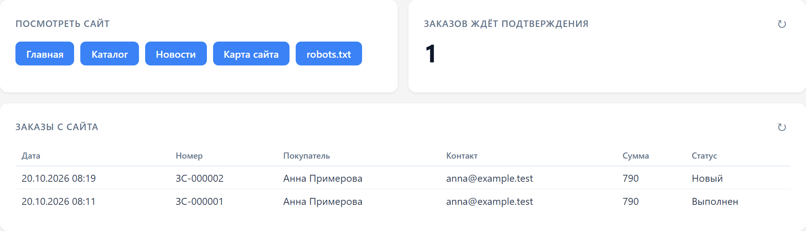

Это развитие открытого примера [examples/cms](../../examples/cms/). Сайт,
каталог и корзина уже появились в нём после предыдущей публикации. К этой статье
я добавил рабочее место менеджера, покупателей, подчинённые адреса и пункты
выдачи, зависимый выбор, историю покупок и печатную форму. Исходники примера
лежат рядом с платформой — его можно запустить и разобрать.

## Сначала посмотрим со стороны покупателя

Сайт отдаётся HTTP-сервисом конфигурации. У него есть страницы, новости, меню,
каталог и карточки товаров. Тексты, оформление и маршруты редактируются из
интерфейса OneBase. Для посетителя это обычный сайт, вход в учётную систему ему
не нужен.


В демонстрации девять товаров с собственными иллюстрациями: три полных ряда
карточек. Здесь кружка, ежедневник, органайзер и другие небольшие товары для
дома и рабочего стола. Для покупки не приходится заполнять карточку контрагента: достаточно имени и почты
или телефона. После оформления появляется страница заказа с номером, составом,
суммой и статусом.

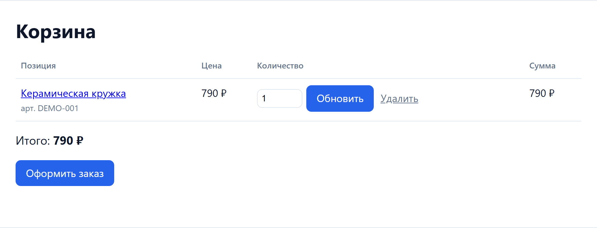

Здесь есть несколько деталей, которые важнее внешнего вида. Цену при оформлении
сервер читает из базы. Название, артикул, цену и валюту он сохраняет в заказе:
если завтра переименовать товар или поменять прайс, старая покупка останется
читаемой. Заказ и закрытие корзины выполняются в одной транзакции; повторная
отправка оформления не должна создавать второй документ. Эти случаи проверяет
тест магазина в самой конфигурации.

Ссылка на заказ содержит случайный UUID и даёт доступ к его странице без входа.
Её надо хранить как личную ссылку: она открывает в том числе оставленный контакт.
Личный кабинет покупателя и отдельная проверка его личности в примере не
реализованы.

Уведомления по почте предусмотрены, но требуют настройки SMTP. Ошибка отправки
сохраняется для менеджера и не отменяет уже записанный заказ. В локальной
демонстрации SMTP не настроен; статья не предполагает, что письма отправлялись.

## Теперь откроем тот же заказ у менеджера

У менеджера отдельная учётная запись и роль `МенеджерЗаказов`. Она разрешает
обрабатывать заказы и вести покупателей с адресами, читать товары и пункты
выдачи. Менять цены в каталоге, править шаблоны сайта или запускать заполнение
демонстрационной базы эта роль не может. В этом примере менеджер видит все
заказы; распределение доступа по сотрудникам здесь не настроено.

Заказ открывается на управляемой форме. Слева — имя и контакт, пришедшие с сайта,
выбранный покупатель, телефон и ответственный. Справа — получение заказа. Ниже —
товары, сумма, команды обработки и другие покупки выбранного покупателя.

Исходный контакт и ссылка на покупателя разделены намеренно. Я не стал
автоматически склеивать людей по введённой почте или телефону: в контакте может
быть опечатка, а одним номером могут пользоваться несколько человек. Менеджер
связывает заказ с нужной карточкой после проверки.

История помогает увидеть предыдущие покупки, не открывая второй список. Это
реквизит формы, который заполняется запросом, а не ещё одна табличная часть
документа. При смене покупателя история перечитывается и не записывается в заказ.

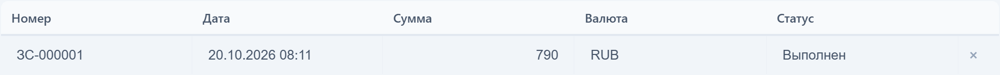

## Цветные области — небольшая настройка с заметным результатом

Мне нравится, когда форму можно понять ещё до чтения всех подписей. Контактные
данные здесь собраны в голубой области, получение — в зелёной, товары — в
светло-жёлтой. Две верхние колонки имеют одинаковую ширину.

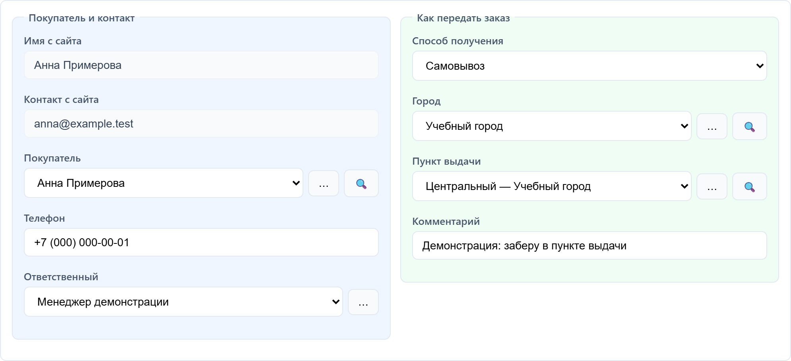

Для этого не понадобилось писать CSS страницы. У группы формы появился
`background`, у горизонтальной группы — `equal_columns`. Например:

```yaml
- kind: ГруппаФормы
  name: Получение
  title: {ru: Как передать заказ}
  background: "#f0fdf4"
  children:
    - kind: ПолеВвода
      name: ПолеСпособПолучения
      data_path: Объект.СпособПолучения
```

Это же свойство доступно в визуальном конструкторе: выбираю группу на холсте
и задаю фон в панели свойств. Получается три связанных представления одной
настройки: YAML выше, конструктор ниже и работающая форма на предыдущем снимке.

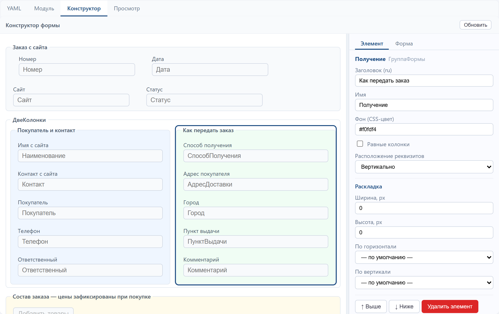

У кнопок тоже можно задавать фон; основной команде достаточно `primary: true`.
Цвет я использую вместе с заголовком, а не вместо него. Смысл области должен
оставаться понятным и без различения оттенков.

Ещё на форме есть маска телефона. Её заполнители в OneBase — `0`, `X` и `*`:
для цифр нужен, например, шаблон `+7 (000) 000-00-00`. Маска помогает вводить
значение, но не подтверждает существование номера.

## Подчинённые справочники и связи параметров выбора

Один покупатель может иметь несколько адресов. Поэтому адрес доставки —
самостоятельный справочник с владельцем:

```yaml
name: АдресаДоставки
owner: Покупатели
fields:
  - name: Наименование
    type: string
  - name: Адрес
    type: string
```

В конфигураторе это обычное свойство справочника: «Подчинён справочнику
(владелец)». В карточке адресов выбран справочник покупателей.

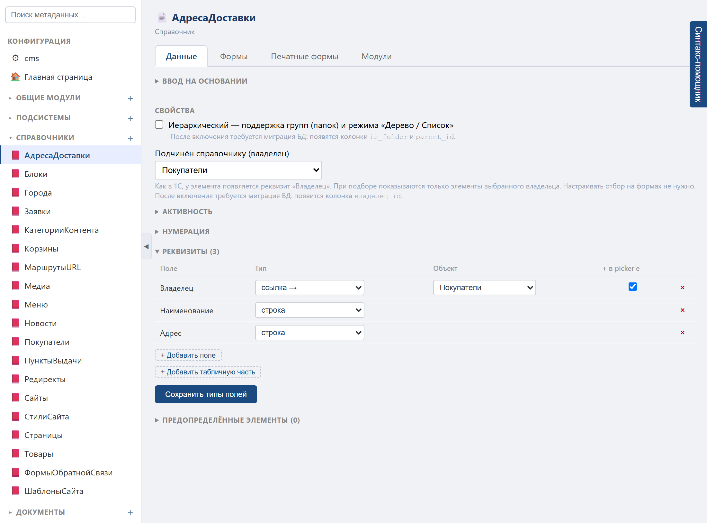

Поле `Владелец` платформа добавляет сама. Тем же способом пункты выдачи
подчинены городам. Это позволяет хранить адреса как отдельные записи и выбирать
их в разных заказах.

На форме связь задаётся через `choice_filter`:

```yaml
- id: cms-order-address
  kind: ПолеВвода
  name: ПолеАдресДоставки
  data_path: Объект.АдресДоставки
  choice: true
  choice_filter:
    - field: Владелец
      op: eq
      from: Объект.Покупатель
```

Условие можно задать и через панель «Зависимый подбор» конструктора формы.
У выбранного поля адреса `field` — это `Владелец`, операция — `eq`, а источник
`from` — `Объект.Покупатель`. Запись YAML и значения в панели описывают одну связь.

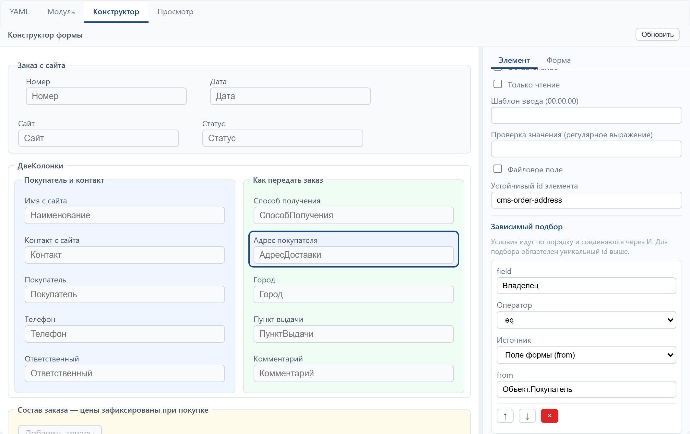

Выбрали Анну — видны её домашний и рабочий адреса. Переключились на Павла —
старый адрес очищается, предлагаются адреса Павла. Очистку делает обработчик
изменения покупателя, а состав вариантов ограничивает платформа.

С самовывозом получается такая же цепочка: сначала город, затем пункт выдачи.
Для этого поля я отключил предварительный выпадающий список через
`choice_dropdown: false`: выбор открывается отдельным окном.

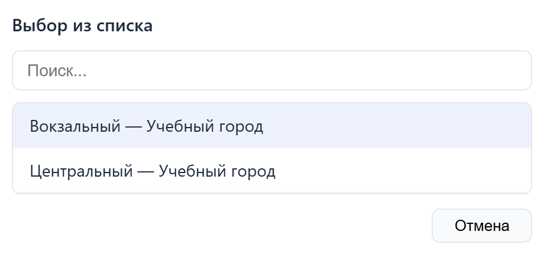

При доставке поля самовывоза скрыты, при самовывозе скрыт адрес доставки.
Обработчик очищает значения другого способа получения. Так форма показывает
то, что требуется для текущего заказа.

Сам по себе отбор на форме ещё не является правилом данных. Поэтому модуль
объекта повторно проверяет, кому принадлежит адрес и в каком городе находится
пункт. Запись чужой ссылки через менеджер объектов тоже отклоняется. Это
отдельно проверяется тестом, который вообще не открывает форму.

В платформе зависимый подбор умеет больше, чем этот пример: есть отбор по
иерархии и исключение ветки, выбор корней, постоянная ссылка в условии, путь
через реквизит ссылки и условия по табличной части выбираемого справочника.
Конкретные варианты и ограничения разобраны в [документации форм](../forms.md).

## Подбор товаров и обработка заказа

Покупатель может попросить добавить ещё товар. Пока заказ новый, менеджер
открывает подбор, указывает количество и переносит выбранные позиции в документ.
В демонстрации к кружке за 790 рублей добавляются два ежедневника по 1190.
Получается 3170 рублей.

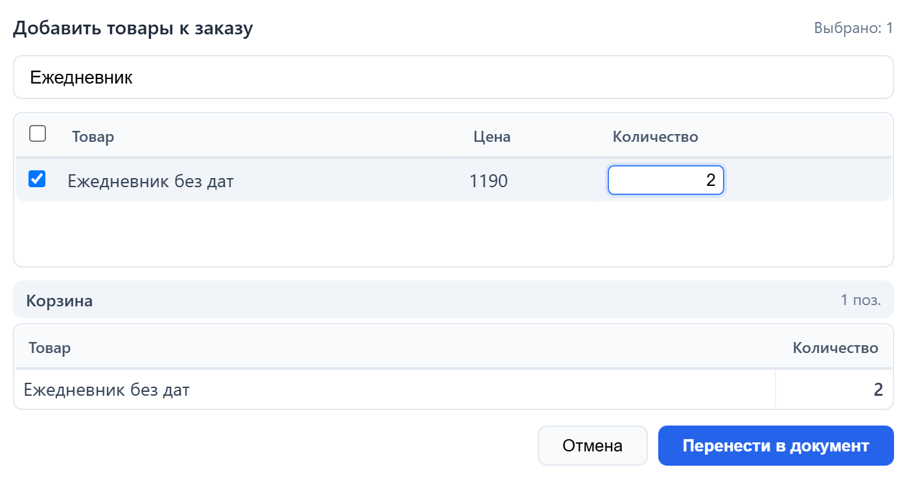

Из диалога обработчик принимает идентификатор товара и количество. Цену,
название и валюту он перечитывает на сервере, проверяет принадлежность товара
сайту и публикацию. Товары в разных валютах в один заказ добавить нельзя.
Прежние строки при этом не переоцениваются по новому прайсу.

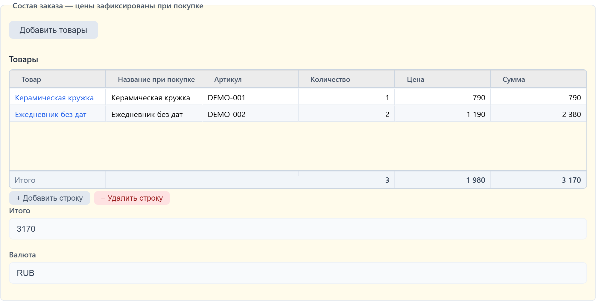

Для статусов задан строгий маршрут:

```text
Новый → ВРаботе → Выполнен
  └────────┴──→ Отменён
```

Перед подтверждением проверяются покупатель, товары и получение заказа.
Команда записывает документ, после чего покупатель видит новый статус на
своей странице. В форме подтверждённого заказа состав становится недоступным
для редактирования. Отмена сначала задаёт вопрос: ответ «Нет» оставляет заказ
в прежнем состоянии.

Маршрут проверяется платформой при записи, поэтому произвольно вернуть
выполненный заказ в новый обычным сохранением не получится. Прикладные
проверки получения выполняются в модуле объекта.

Есть и печатная форма заказа: она использует сохранённые названия и цены строк,
открывается в HTML и выгружается в PDF. Для неё добавлен небольшой YAML-макет.

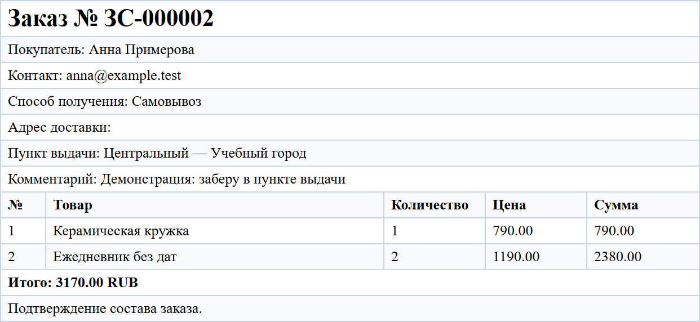

После завершения менеджером статус меняется и на публичной странице:

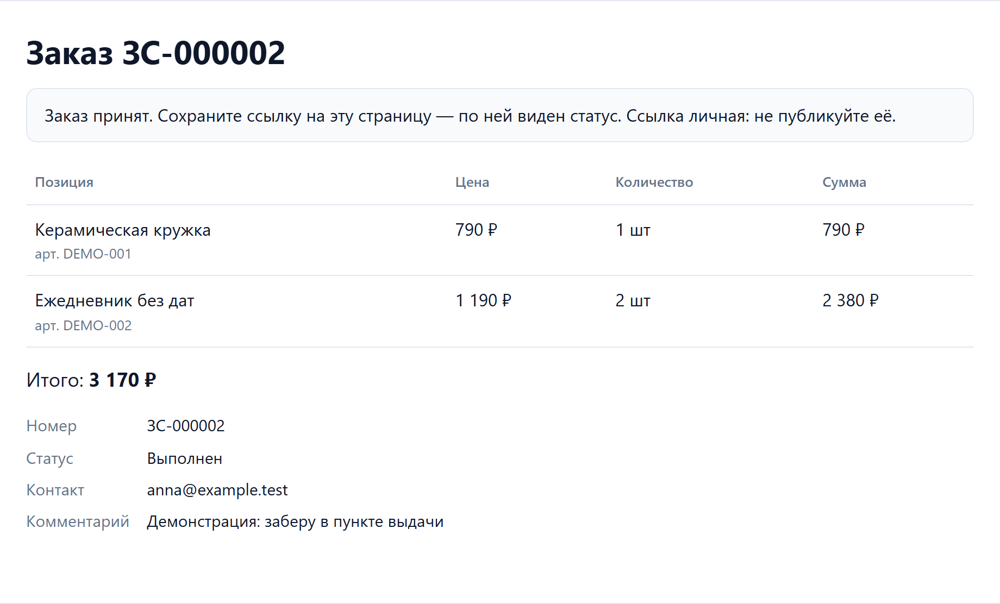

## Что ещё добавилось после предыдущей статьи

За сайтом легко пропустить остальные изменения. В каталоге возможностей есть
140 записей с датами с 8 августа по 19 октября. Это записи документации о
возможностях и доработках, а не утверждение о 140 совершенно новых подсистемах.
Часть помечена `stable`, часть всё ещё `testing`; эти статусы сохранены в
[полном приложении к статье](onebase-changes-aug-oct-2026.md).

Здесь соберу их по тому, что они дают разработчику и пользователю.

**Формы и повседневная работа.** Помимо цветных областей появились размеры и
выравнивание элементов, равные колонки, плотные строки, условная доступность
группы целиком, маски ввода, вопрос пользователю и открытие другой карточки из
обработчика. Развились настройка колонок и события табличных частей, управление
с клавиатуры и создание копированием. Есть отказ от закрытия формы, боковая
панель деталей и настройка её состава. Для диалогов подбора добавились поиск
на сервере, одиночный выбор, отборы, настройка ширины и работа через Enter
или двойной щелчок.


**Навигация и рабочий стол.** Меню конфигурации можно собирать визуально:
смысловые разделы, смешанные папки, порядок элементов. Общая настройка
и личные изменения пользователя хранятся отдельными слоями. У списковых
виджетов появились фильтры и переход в карточку записи, обновление отдельной
карточки рабочего стола и вариант «мои записи». В примере список последних
заказов теперь открывает документ по щелчку, а изменения заказов дают событие
для обновления виджетов.

В примере раздел «Продажи» объединяет заказ, покупателей и получение.
Вложенные папки задаются в конфигурации; редактор показывает структуру и
предпросмотр того, что увидит пользователь.

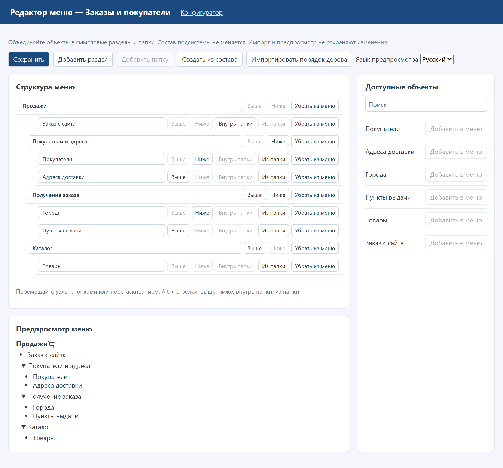

**Отчёты, Excel и печать.** Печатную форму можно подготовить из бланка Excel.
У параметров отчёта появились значения по умолчанию, время суток, константа
конфигурации и корректная трактовка отбора «по дату» как конца дня. Есть
«Мои выгрузки отчётов», импорт Excel в справочник и REST API v2 для печатных
форм. В этой демонстрации используются HTML и PDF; импорт Excel и остальные
режимы отчётов в её сценарий не включены.

На снимке — тот самый макет заказа. Кнопки импорта из Excel и PDF находятся
в редакторе макета; проверенная печать этого примера показана выше.

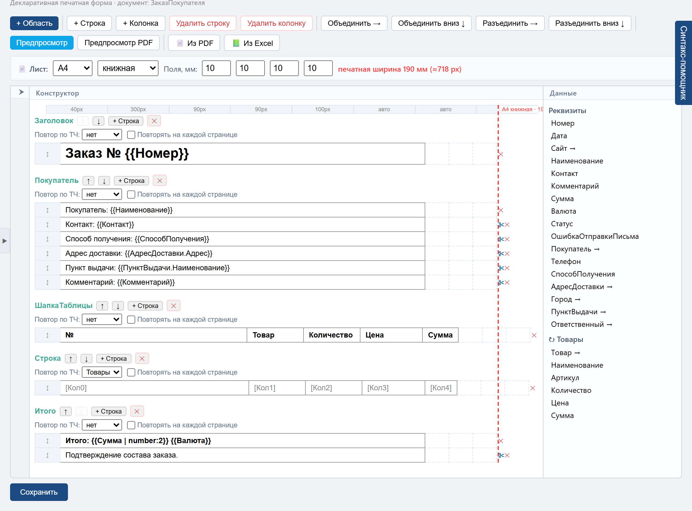

**Данные и язык конфигурации.** Подчинённые справочники, индексы по реквизитам
и индексы регистров сведений, представление объекта своим полем, значения
по умолчанию, стандартные код и номер без дублирования, уникальность и настройка
нумерации. В запросах развились обращение через ссылку, `ПЕРВЫЕ`, `ИМЕЮЩИЕ`,
агрегаты и системные колонки документов. В языке появились новые операции
с датами, массивами, файлами, XML, динамическими менеджерами объектов и
регистрами сведений. Для обмена с 1С добавлен `СериализаторXDTO`.

Связи между справочниками видны в карточке владельца, а условия выбора —
в конструкторе, показанном выше. Прикладные проверки остаются в обычном модуле
конфигурации. На снимке ниже — проверка принадлежности адреса и пункта выдачи,
которую выполняет сервер при записи заказа.

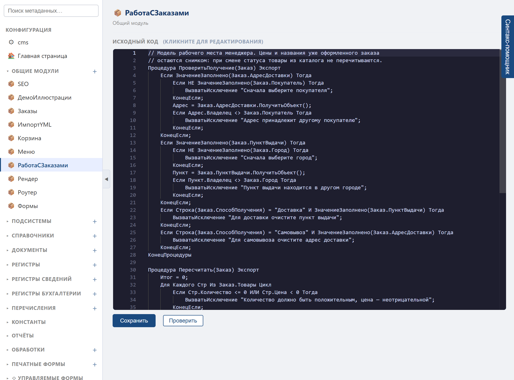

**Сайт и интеграции.** HTTP-сервисы получили HTML-шаблоны, приём форм, кэш
ответов, сжатие и заголовки безопасности. Есть публичные ссылки на файлы,
регулярные выражения, WebSocket-клиент и расширения REST API v2, включая
чтение регистра сведений. В самом CMS-примере за это время появились витрина
карточками, главная с разделами и новостями, рабочий стол управления сайтом,
корзина и оформление заказа. Каталог можно загружать из YML.

HTML-шаблон публичного сайта тоже можно открыть в конфигураторе. В примере
данные передаются в шаблон отдельно от разметки, а не склеиваются с HTML
пользовательскими строками.

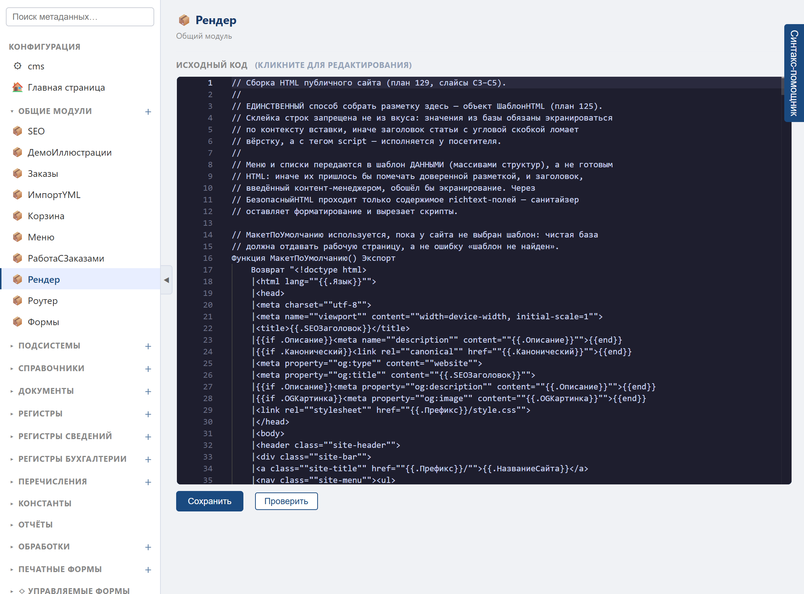

**Фоновая работа и доступ.** Очередь заданий получила пул исполнителей;
параллельная обработка требует PostgreSQL, в SQLite исполнитель один.
Регламентные задания можно включать, выключать и запускать из кода. Учётную
запись входа можно связать с карточкой сотрудника и строить доступ к строкам
по её реквизитам. Есть настройка политики паролей, работа с зашифрованным
секретом в данных и просмотр сохранённых вложений в браузере. Всё это требует
настройки в конкретной конфигурации: роль из этой статьи не демонстрирует
все варианты разграничения доступа.

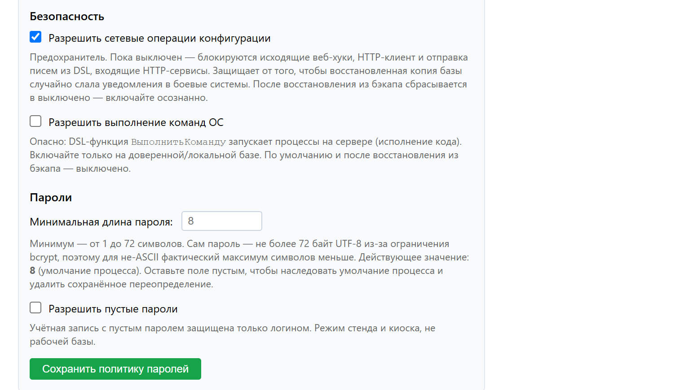

**Разработка и обслуживание.** Условные точки останова, обновление страницы
в цикле разработки, пересборка платформы на лету, полный справочник языка,
команды управления предохранителями и версиями. Добавились подпись обновлений,
защита от открытия новой базы старым бинарём, минимальная версия платформы
для конфигурации и проверка ссылок на учётные записи перед миграцией. Есть
сборки под ARM, подключение лаунчера к работающему серверу и развитие
локализации. Для оценки переноса из 1С появилась команда замера исходной
конфигурации, а среди прикладных примеров — адрес выезда и рабочее место кассира.

Справочник языка доступен прямо из редактора: поиск находит функцию,
её параметры и описание, а кнопка вставляет вызов в модуль.

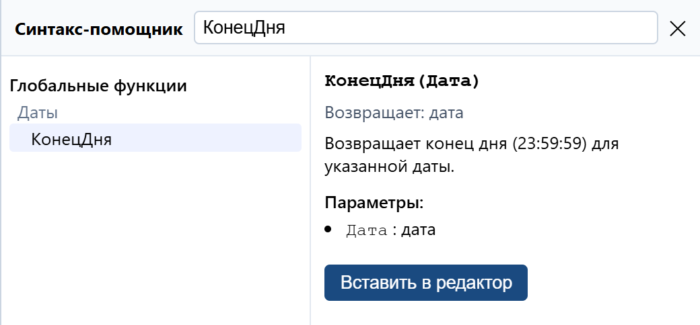

Исправления движка, миграций и проверок доступа перечислены в
[истории изменений](../../CHANGELOG.md) и
[заметках к v0.13.0](../releases/release_v0.13.0.md). Здесь я не пытаюсь
выдать каждое исправление за отдельную новую возможность.

## Как попробовать

Скачайте [архив релиза OneBase](https://github.com/ivanarama/onebase/releases),
в котором есть готовый пример **«Сайт и заказы»**, и распакуйте его. Внутри
находится файл `demo/cms-orders.db`: конфигурация, товары с картинками,
покупатели и предыдущий заказ уже подготовлены.

1. Откройте OneBase и нажмите **Добавить** в лаунчере.
2. Выберите хранение конфигурации **В базе данных**, тип базы
   **Файловая (SQLite)** и файл `demo/cms-orders.db`. Пустую конфигурацию
   создавать не нужно. Нажмите **Добавить**.
3. Выберите базу и нажмите **Предприятие**. Логин `manager`, пароль
   `DemoOrders2026!`. В блоке **Посмотреть сайт** на рабочем столе нажмите **Каталог**.

Для просмотра устройства примера нажмите **Конфигуратор** в лаунчере:
`admin` / `DemoLocal2026!`. Это общедоступные пароли локального учебного
примера. Для экспериментов достаточно отдельной копии файла базы.
[Техническая инструкция](../../examples/cms/ARTICLE-DEMO.md) остаётся для тех,
кто хочет собирать платформу, менять исходники и запускать тесты.

Скриншоты в статье сняты с работающего примера и его конфигуратора.
Перенос готовой базы и полный сценарий также проверены на Orange Pi (Linux/ARM64). Проверены шесть
тест-обработок конфигурации, повторное заполнение данных и браузерная цепочка:
оформление, зависимые поля, история, подбор товаров, подтверждение, печать
в HTML/PDF, выполнение и оба ответа на вопрос об отмене.

Это пример сайта и обработки заказов. Оплата, фискализация, резервирование
остатков и расчёт тарифов доставки сюда не включены. Его можно развивать под
свою задачу, а можно брать отдельные приёмы: связанный выбор, подчинение,
оформление формы, историю или маршрут документа. Для этого и хотелось собрать
их в одном небольшом открытом приложении.
