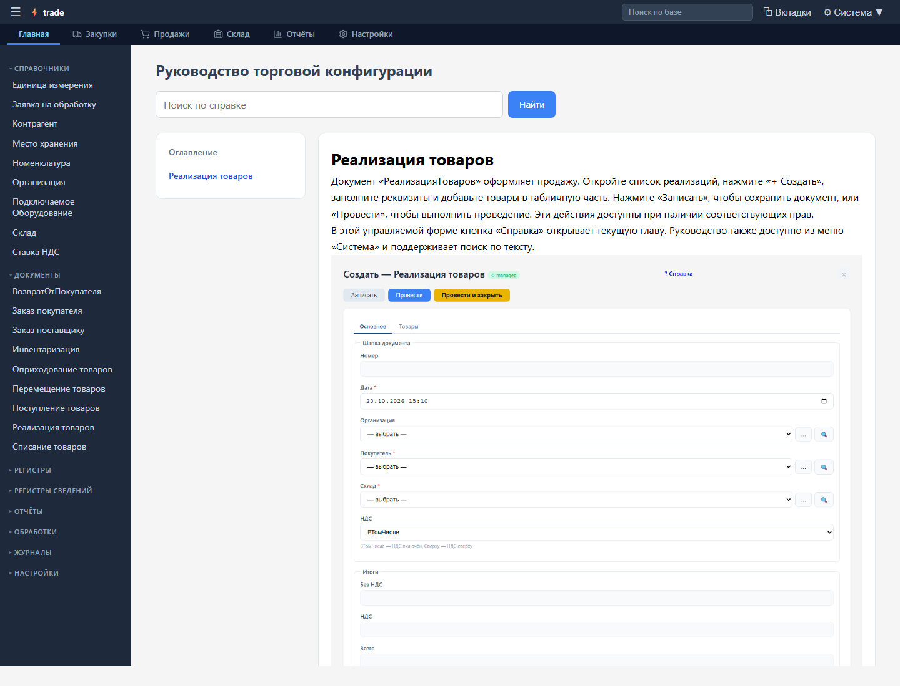

<!-- summary: Пользовательская справка внутри приложения, гибкие диалоги и подбор ссылок, интерфейсы HTTP-сервисов во вкладках и переносимый запуск. Исправлены запросы, проведение и миграции; обновлены компоненты безопасности. -->

## Главное



`v0.14.0` закрепляет изменения после `v0.13.0`. Разработчик конфигурации может
поставлять руководство вместе с приложением, настраивать поля диалога вопроса,
подбор ссылок и открывать интерфейс своего HTTP-сервиса внутри OneBase.
Пользователи получили точнее работающие формы, списки и печать.

На скриншоте — работающая справка примера «Торговля и Склад» на
демонстрационной базе текущего кода платформы.

## Руководство рядом с формой

Пользовательская справка хранится в конфигурации: оглавление, статьи Markdown
и локальные иллюстрации. Руководство открывается из меню «Система», а кнопка
«Справка» в форме ведёт к связанной статье. Работает поиск по тексту.
Каркас создаёт `onebase docs init`; статьи проверяются вместе с конфигурацией
(#2234). Переходы из статей к объектам дополнительно проверяются по правам
пользователя (#2415).

Руководство пишет автор конфигурации. Платформа не вызывает ИИ автоматически
при открытии справки или работе с документами.

## Формы, диалоги и подбор

- В `ПоказатьВопрос` можно добавить поля ввода и получить заполненные значения
  в обработчике ответа (#2257), выделить важность поля (#2334). Вопрос работает
  при открытии формы и перед проведением документа (#1990, #2106).
- Для зависимого подбора появился запрос `choice_filter_query` (#2337).
  Поиск иерархического справочника охватывает весь справочник (#2266).
  Строки выбора ссылок можно оформлять условием (#2366).
- Поле формы поддерживает всплывающую подсказку, скрытие значения и жирное
  начертание (#2276, #2282, #2518); условное оформление умеет подсвечивать
  сроки (#2281).
- Заголовок колонки табличной части можно брать из реквизита (#2190), а
  ширину колонок задавать и в простой таблице (#2180). Выделенная строка
  сохраняется при обновлении сетки (#2356).
- В конфигурации можно закрепить режим открытия форм (#2354), а подсистемы
  переключаются без полной перезагрузки оболочки (#2133). Исправлено
  переименование вкладки при позднем ответе другой формы (#2553).
- `messages: popup` показывает сообщения всплывающими плашками без нижней
  панели и дублирования (#2519). Параметр обработки с типом `enum:X` теперь
  действительно предлагает значения перечисления (#2316).

## Страницы, запуск и интеграции

- `Страница.ВстроитьСервис` открывает локальный интерфейс `/hs/` внутри
  приложения. Высота рабочей области вкладок ограничена окном, включая узкий
  экран (#2439).
- Переносимый режим позволяет держать окружение разработки рядом с программой
  (#2335). Bootstrap-установка сохраняет существующий CLI и не меняет
  постоянный `PATH` (#2108).
- В DSL добавлены получение почты по POP3/IMAP, сохранение HTTP-ответа в файл
  и работа с уникальным идентификатором (#2270, #2232, #2343).
- В поставке описаны лицензия, условия коммерческого использования и сведения
  о форке (#2245).

## Запросы, доступ и надёжность

Запросы поддерживают источник из табличной части (#2175). Исправлены
преобразование агрегированных дат (#2223), поля присоединённых источников
(#2542), сравнение пустых ссылок и строковых параметров PostgreSQL
(#2552, #2547), точность и типы результатов SQLite (#2034).

Подбор в колонках табличной части учитывает зависимости (#1973). Строковый
доступ может использовать набор филиалов из табличной части карточки
сотрудника (#2480). Исправлены проверка права создания через события формы
(#2165), восстановление значения ссылки после подбора (#2173), вызов хука
отмены проведения при пометке и удалении документа (#2110).

Печать PDF корректнее размещает текст в узких ячейках (#2189), а Excel-макеты
сохраняют заказанный числовой формат в текстовых ячейках (#2433).
Сборки используют Go 1.26.11 (#2572); обновлены обработка недоверенных книг
Excel и HTML-парсер форматированного текста (#2231, #2513, #2546).

## Перед обновлением рабочей базы

В этой версии есть изменения поведения и схемы. Сначала сделайте резервную
копию и проверьте обновление на копии базы. Все накопленные предупреждения
сохранены в [разделе v0.14.0 CHANGELOG](https://github.com/ivanarama/onebase/blob/v0.14.0/CHANGELOG.md#v0140--2026-11-16).

Особенно проверьте:

- **Длинные SQL-имена.** Новая миграция использует одинаковое сокращение с
  хешем на SQLite и PostgreSQL. Сначала выполните `migrate --dry-run`;
  неоднозначное соответствие имён останавливает миграцию (#1949).
- **Индексы и уникальность.** Управление существующими индексами учитывает
  доказанное владение; старые индексы могут потребовать явного принятия по
  манифесту. Не удаляйте внешние индексы вручную по одному совпадению имени
  (#2145).
- **Ссылки на пользователей в PostgreSQL.** Миграция устанавливает внешний
  ключ и отклоняет битые ссылки. Нужны проверка данных и окно обслуживания;
  эволюция старых таблиц SQLite, табличных частей и регистров сюда не входит
  (#2523).
- **Регистры сведений.** Добавлена служебная версия `_edit_revision`.
  Остановите запись старым бинарём, предусмотрите время на заполнение версий
  больших регистров и исключите одноимённое бизнес-поле (#2206).
- **Программное закрытие формы** теперь может закрыть исходную форму без
  вопроса о сохранении. Нужные данные обработчик должен записать до команды
  закрытия; новые пользовательские правки сохраняют защиту (#2429).
- **Обычный `ПоказатьВопрос` не закрывается щелчком по фону.** Для отмены
  предусмотрите явную кнопку и обработку ответа (#2478).
- **Форматирование чисел, SQL-типы и печать** могли раньше давать ошибочный
  результат. Сверьте свои отчёты и печатные формы, особенно числовые `MIN/MAX`,
  флаги документов, `Формат`, агрегированные даты и JOIN-запросы
  (#2185, #2034, #2223, #2542).
- **TLS и импорт Excel.** Новые компоненты отклоняют известные недоверенные
  цепочки сертификатов и повреждённые книги. Исправляйте внешний источник,
  сохраняя проверку сертификатов (#2265, #2572, #2231).

Проверьте свою конфигурацию командой `onebase check --project <каталог>`,
затем миграцию и рабочие сценарии под используемыми ролями и на своей СУБД.
Общая проверка платформы не заменяет прикладную приёмку частной конфигурации.
Изменения из ещё открытых PR в эту версию не входят.

## Установка

### Windows

Скачайте `onebase-windows-amd64.zip`, распакуйте и запустите
`onebase-gui.exe`. Для Windows ARM используйте `onebase-windows-arm64.zip`
и `onebase.exe start`: в этом архиве нет GUI-бинаря, лаунчер работает в браузере.

### Linux

```bash
tar xzf onebase-linux-amd64.tar.gz
./onebase-linux-amd64/onebase start
```

Для ARM используйте `onebase-linux-arm64.tar.gz`.

### macOS

```bash
tar xzf onebase-darwin-arm64.tar.gz
./onebase-darwin-arm64/onebase start
```

Для Intel Mac используйте `onebase-darwin-amd64.tar.gz`.

При ручном обновлении замените используемый бинарь и проверьте `onebase version`:
распаковка нового архива сама по себе не заменяет старую программу в `PATH`.
Самообновление проверяет подпись по
[инструкции](https://github.com/ivanarama/onebase/blob/v0.14.0/docs/release-signing.md).
PostgreSQL нужен для соответствующего режима работы; SQLite не требует
отдельного сервера СУБД.

## Полный состав PR

Перечень ниже охватывает весь first-parent диапазон после `v0.13.0`.
Служебные изменения и планы включены для полноты: влитый план сам по себе
не означает появления возможности в продукте.

- #2100, #2165, #2228, #1180, #2231, #2112, #2130, #2160, #2234, #2235, #2185, #2186, #2187, #2189, #2223
- #2184, #2265, #1973, #2133, #1915, #2237, #2252, #2059, #2274, #2256, #2246, #2181, #2173, #1949, #2319
- #2321, #2322, #1990, #2224, #2269, #2272, #2278, #2336, #2341, #2145, #2340, #2108, #1871, #1984, #1975
- #2342, #2174, #2034, #2106, #2170, #2320, #2344, #2335, #2345, #2346, #2347, #2348, #2350, #2349, #2245
- #2105, #2271, #2180, #2244, #2368, #2232, #2354, #2337, #2266, #2369, #2270, #2401, #1614, #2408, #2409
- #2410, #2411, #2412, #2413, #2414, #2282, #2415, #2276, #1482, #2175, #2190, #2236, #2264, #2399, #2400
- #2416, #2424, #2425, #1983, #2427, #2430, #2432, #2433, #2435, #2437, #2438, #2281, #2257, #2202, #2449
- #2451, #2452, #2453, #2454, #2456, #2436, #2457, #2355, #2450, #2466, #2468, #2472, #2473, #2476, #2474
- #2516, #2479, #2524, #2110, #2529, #2356, #2206, #2528, #2210, #2464, #2448, #2518, #2243, #2531, #2513
- #2480, #2542, #2541, #2465, #2546, #2547, #2545, #2525, #2478, #2548, #2552, #2523, #2553, #2549, #2551
- #2554, #2560, #2562, #2563, #2334, #2429, #2316, #2565, #2343, #2572, #2519, #2221, #2366, #2605, #2439

Полное сравнение: [v0.13.0…v0.14.0](https://github.com/ivanarama/onebase/compare/v0.13.0...v0.14.0).
