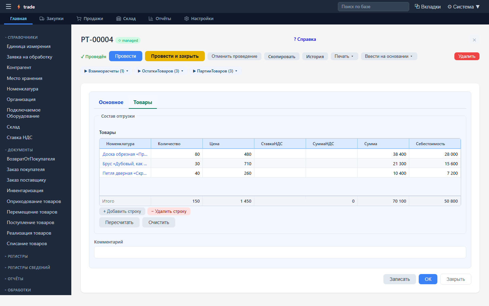

<!-- summary: Оформление управляемых форм, выгрузка регистров в Excel и проверка резервных копий SQLite. Уточнены запросы и права запуска обработок. -->

## Главное

В OneBase v0.15.0 разработчик конфигурации может оформлять заголовки полей,
таблиц и закладок, фильтровать список значением из запроса и выводить в форме
изображение выбранного вложения. Пользователи могут скачивать CSV из командной
панели списка и прослушивать аудиовложения. Администратор может проверить
резервную копию SQLite пробным восстановлением.

На скриншоте документ «Реализация товаров» из демонстрационной конфигурации «Торговля и Склад». В форме заданы цвет и жирность заголовков закладок, фон группы и цвета шапки таблицы.

## Формы, списки и вложения

- Для закладок настраиваются цвет и жирность заголовков (#2475), а также фон
  набора страниц и полосы закладок (#2300). У шапки таблицы появились настройки
  фона и границ (#2294), у подписей полей — цвет (#2706).
- `value_query` отбирает строки списка по ссылке, полученной запросом до
  подсчёта строк и разбивки на страницы. При пустом, неоднозначном или
  некорректном результате пользователь получает пустой список (#2722).
- Форме списка можно задать постоянный отбор для выбранных ролей. Он
  применяется к списку, подгружаемым узлам дерева и экспорту в Excel вместе
  со строковыми правами доступа. Отбор запросом учитывает и папки (#2172).
- Из командной панели списка можно запустить доступную пользователю обработку
  и скачать сформированный ею CSV в браузере (#2714). Обычный XLSX отчёта
  или списка теперь объявляет диапазон всех записанных ячеек, включая
  оформленные пустые ячейки (#2632).
- Движения и остатки регистра накопления и список регистра сведений можно
  выгрузить в Excel. В XLSX действуют те же права доступа, маски и отборы,
  что и в списке. Для регистра сведений выгружается текущая страница (#2358).
- Аудиовложения можно слушать с перемоткой прямо в приложении (#2313). В форме
  можно вывести превью выбранного изображения и открыть его в полном размере
  (#2177).
- Закрытие управляемой формы ждёт завершения текущего события до таймаута
  (#2295). Пустой пункт выпадающего списка ссылки учитывает доступность поля
  (#2312). Настройка `actions.copy.visible: false` скрывает команду
  «Скопировать» на карточке (#2291).
- Управляемые формы поддерживают периодические и однократные обработчики
  ожидания. Их можно использовать, например, чтобы обновлять на форме статус
  внешней операции (#2418).

## Запросы и прикладная логика

- `НРег` переводит текст в нижний регистр. SQLite использует Unicode-правила,
  PostgreSQL применяет правила регистра своей базы. Для поиска можно
  использовать `НРег(Поле) ПОДОБНО &Поиск`
  с параметром в нижнем регистре (#2614).
- SQLite точнее сравнивает даты регистров сведений и накопления с параметрами
  даты. Исправлены границы `МЕЖДУ` и учтены ранее записанные значения RFC3339
  (#2188).
- Из модуля можно выставить и снять пометку удаления у элемента справочника.
  Операция проверяет право на удаление (#2530).
- Карточка и боковая панель показывают пользователю явную причину отказа из
  `ПриЧтенииНаСервере`. При техническом сбое браузер показывает общую
  страницу 403 (#2426).
- В примере Trade проведение по ФИФО корректно берёт партии без организации
  для документа с пустой организацией. Движения разных организаций
  учитываются раздельно (#2657).

## Резервные копии и конфигуратор

- `onebase backup verify` пробно восстанавливает копию SQLite во временном
  каталоге и сверяет количество проведённых документов с эталоном. Расхождение
  даёт ненулевой код возврата. Для автоматизации есть отчёт `--json` (#2710).
- Конфигуратор снова может генерировать каркас через DeepSeek с прежними
  настройками подключения (#2712).

## Перед обновлением

- **Проверьте настройку 2FA за HTTPS-прокси.** Настройка 2FA из профиля
  учитывает политику HTTPS сервера. После обновления пройдите этот сценарий
  через используемый прокси (#2756).

- **Проверьте права на запуск обработок.** При отсутствующей, пустой или
  равной `null` секции `permissions.processors` обычная роль сама по себе
  больше не даёт права запуска. Права нескольких ролей складываются.
  Перечислите нужные обработки с правом `[run]`. Если нужен прежний
  общий доступ, укажите `processors_default: allow` без секции
  `permissions.processors`. Проверьте конфигурацию командой
  `onebase check --project <каталог> --lint` и обновите все экземпляры сервера,
  работающие с общей базой, одновременно (#2658).
- **Перепроверьте формы с существующими настройками.** Уже заданный
  `background` набора страниц и `actions.copy.visible` теперь применяются.
  Видимость команды копирования задаётся отдельно от права создания.
  В сценариях с автотестами проверьте пустой вариант ссылочного списка
  (#2300, #2291, #2312).
- **Проверьте одноимённые процедуры менеджеров справочников.** Встроенные
  методы пометки удаления теперь имеют приоритет перед одноимёнными
  пользовательскими процедурами (#2530).
- **Проверьте постоянные отборы иерархических списков.** Запросы в
  `form.filter.query` должны возвращать ссылки на нужные папки. Пустой
  результат `value_query` скрывает также папки. Запустите `onebase check`,
  если используете системные поля наподобие `Автор.login`. Миграция данных
  не требуется (#2172).
- **Сверьте отчёты и выгрузки.** Проверьте помесячные отборы и время больших
  отчётов по датам регистров на SQLite, а также чтение последней строки XLSX
  в скриптах, которые обходили ограничение диапазона A1 (#2188, #2632).
- **Проверьте длинные значения в Excel-выгрузке регистров.** Если ячейка или
  заголовок содержат более 32767 единиц UTF-16, выгрузка покажет причину отказа.
  Полный текст можно посмотреть в списке (#2358).
- **Обновите прикладной модуль Trade**, если ваша конфигурация использует
  исправленный сценарий ФИФО. Проверьте проведение документа с пустой
  организацией на копии базы (#2657).

## Сборка и сопровождение

- В заметке предварительной сборки один пункт на влитый PR и ссылка на полное
  сравнение (#2749). Если на macOS GitHub не выделил раннер, а остальные
  задания прошли, предварительная сборка повторяет это задание один раз
  (#2735).
- Проверка PostgreSQL разбита на четыре группы UI и отдельную группу
  остальных пакетов (#2731). Для тяжёлого пакета с детектором гонок увеличен
  лимит времени (#2666). Три Windows-теста учитывают нормализацию временных
  путей (#2721), а шесть HTTP-тестов лаунчера проверяют ошибки остановки
  сервера (#2752).
- FIX повторно использует сохранённые проверки при совпадении входов (#2750).
  MERGE умеет продолжать работу после обновления ветки (#2730) и при
  соответствующей настройке освобождает воркер на время ожидания CI (#2744).
  Включаемая очередь замечаний сохраняет найденные задачи и восстанавливает
  ход обработки после сбоя (#2729, #2745).
- `pipelinehealth` согласованно сравнивает время редактирования комментариев
  и может выдавать квитанцию расхода GraphQL (#2711, #2660). Явный запрос на
  повторное полное ревью возвращается в очередь ревью (#2649).

## Установка

Для Windows x64 распакуйте `onebase-windows-amd64.zip` и запустите
`onebase-gui.exe`. На Windows ARM используйте `onebase-windows-arm64.zip`
и команду `.\onebase.exe start`.

На Linux и macOS выберите архив для своей архитектуры и запустите
`./onebase start` из каталога с распакованным исполняемым файлом. После ручного обновления
убедитесь, что `onebase version` показывает установленную версию, и прогоните
`onebase check --project <каталог>` на своих конфигурациях.

<!-- release-check: omit #2758 reason=этот PR подготовил заметку v0.15.0, CHANGELOG и скриншот -->
