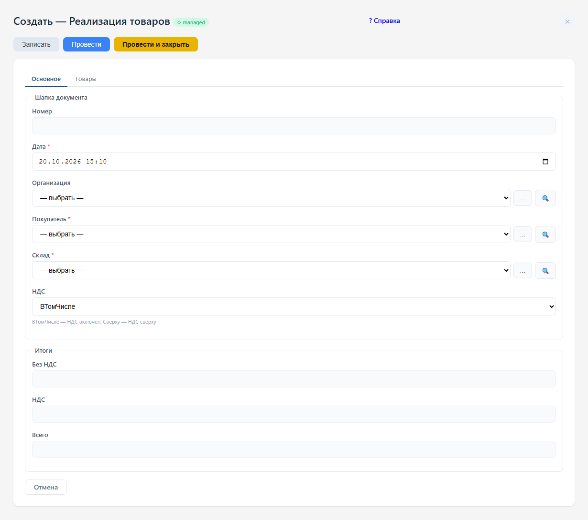

# Реализация товаров

Документ «РеализацияТоваров» оформляет продажу. Откройте список реализаций,
нажмите «+ Создать», заполните реквизиты и добавьте товары в табличную часть.
Нажмите «Записать», чтобы сохранить документ, или «Провести», чтобы выполнить
проведение. Эти действия доступны при наличии соответствующих прав.

В этой управляемой форме кнопка «Справка» открывает текущую главу.
Руководство также доступно из меню «Система» и поддерживает поиск по тексту.

